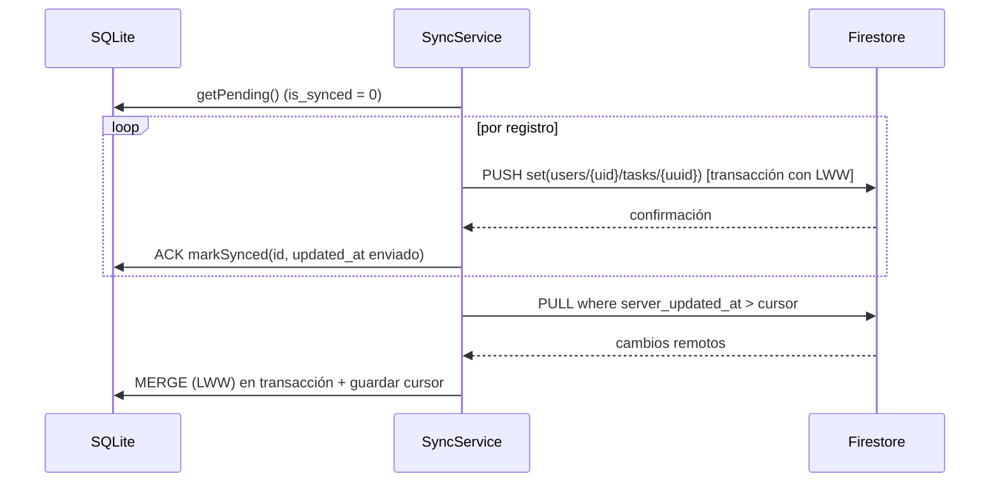

# Documentación técnica — Arquitectura Offline-First en Flutter

## 1. Principios
1. **Single Source of Truth:** la UI solo lee de SQLite (`watchVisible()`); nunca de la red.
2. **Disco primero:** cada escritura se confirma en SQLite (`is_synced = 0`) y la UI se actualiza al instante.
   La red es un efecto secundario (latencia percibida ≈ 0 ms).
3. **Sincronización eventual:** cuando hay red, un ciclo Push → ACK → Pull → Merge converge local y nube.
4. **Resiliencia:** si la app se cierra, Workmanager completa la sincronización cuando haya red.

```
UI ──► TaskRepository ──► TaskLocalDataSource ──► SQLite (tasks)         ◄── única fuente de verdad
              │                                      ▲
              ├─► BackgroundScheduler (Workmanager)  │ merge / ack
              └─► SyncService ──► RemoteTaskDataSource ──► Firestore users/{uid}/tasks/{uuid}
                       ▲
        ConnectivityService (onConnectivityChanged)
```

## 2. Dependencias
| Paquete | Uso en el proyecto |
|---|---|
| `sqflite` | SQLite embebido: tabla `tasks` y `sync_meta`. |
| `path` | `join(getDatabasesPath(), 'offline_first.db')`. |
| `connectivity_plus` | `onConnectivityChanged` → al pasar de offline a online se dispara el sync y se pinta el estado en la UI. Informa de interfaces de red, no de Internet real: por eso hay timeouts y reintentos. |
| `workmanager` | `registerOneOffTask` con `NetworkType.connected` y `requiresBatteryNotLow`: el sistema ejecuta el sync con la app cerrada, solo con red y sin gastar batería en vano. |
| `uuid` | UUID v4 generado en el cliente: identifica el registro antes de que exista en la nube (idempotencia). |
| `flutter_secure_storage` | Tokens y UID en Android Keystore / iOS Keychain (cifrado en reposo). |
| `firebase_*` | Auth (identidad/UID) y Firestore (backend). |

## 3. Modelo de datos local
```sql
CREATE TABLE tasks (
  id         TEXT PRIMARY KEY,            -- UUID v4
  title      TEXT NOT NULL,
  is_synced  INTEGER NOT NULL DEFAULT 0,  -- 0 pendiente · 1 sincronizado
  updated_at TEXT NOT NULL,               -- ISO-8601 UTC, milisegundos (formato fijo)
  is_deleted INTEGER NOT NULL DEFAULT 0   -- soft delete
);
CREATE INDEX idx_tasks_pending ON tasks (is_synced);
CREATE TABLE sync_meta (key TEXT PRIMARY KEY, value TEXT NOT NULL); -- pull_cursor, owner_uid
```
- **Soft delete:** borrar = `is_deleted = 1`, `is_synced = 0`, `updated_at = ahora`. El borrado viaja como un cambio más
  y se propaga a otros dispositivos. La UI filtra `is_deleted = 0`.
- **`updated_at` siempre UTC con milisegundos** → formato de longitud fija; el orden de texto coincide con el cronológico.
  Además `saveLocal` garantiza que `updated_at` crece estrictamente por registro.
- **`sync_meta`:** `pull_cursor` (último `server_updated_at` visto) y `owner_uid` (dueño de la base local).

## 4. Escritura local inmediata (`saveLocal`)
```
saveLocal(task):  task.copyWith(is_synced: false, updated_at: ahora)  →  INSERT OR REPLACE  →  notifica al stream
```
La UI se redibuja desde el stream sin esperar respuesta de red. Después, `TaskRepository._afterLocalWrite()` encola
Workmanager y, si hay red, lanza el sync en segundo plano (sin `await` en la UI).

## 5. Sincronización bidireccional

1. **PUSH:** envía cada registro con `is_synced = 0` (incluidos tombstones).
2. **ACK:** `UPDATE … SET is_synced = 1 WHERE id = ? AND updated_at = ?`. Si el usuario editó el registro mientras
   subía, `updated_at` cambió, el ACK no aplica y el registro sigue pendiente: **no se pierde ninguna edición**.
3. **PULL:** consulta incremental por `server_updated_at` (hora del servidor, inmune a relojes desajustados).
4. **MERGE (LWW):** `MergeResolver.resolve(local, remote)`:
   - no existe local → insertar (si es tombstone, ignorar);
   - `remote.updated_at > local.updated_at` → gana la nube (se guarda con `is_synced = 1`);
   - en otro caso (menor o empate) → se conserva lo local (determinista).
5. El PUSH también aplica LWW en el servidor (transacción): una edición vieja nunca pisa una más nueva; el siguiente PULL
   trae la versión ganadora.

### Idempotencia
El ID del documento en la nube **es** el UUID generado en el cliente y se escribe con `set`. Reintentar un envío
(corte de red tras enviar, Workmanager + app abiertos a la vez, doble toque en "sincronizar") sobrescribe el mismo
documento y nunca crea duplicados. `SyncService` además usa un candado (`_running`) para un solo ciclo por isolate.

## 6. LWW vs. control de versiones incremental
**LWW es suficiente** cuando: un usuario edita sus propios datos, los conflictos son raros, el dato es pequeño y perder
una edición concurrente es tolerable (esta práctica).

**Conviene versionado incremental** (`version INTEGER`) cuando: los relojes no son confiables, varios usuarios editan el
mismo registro, hay campos que deben fusionarse (no sobrescribir el documento completo) o se requiere auditoría.
Esquema: el cliente guarda `base_version`; el servidor acepta solo si `base_version == version_actual`, incrementa
`version` y, si no coincide, responde conflicto (HTTP 409) para que el cliente fusione campo a campo o pregunte al usuario.

## 7. Seguridad
- **Tokens cifrados en reposo:** `SecureTokenStorage` (Keystore/Keychain). Nunca en SQLite ni SharedPreferences, ni en logs.
  El SDK de Firebase gestiona su propio refresh token; el almacén seguro guarda UID + ID token para decidir si el
  worker puede sincronizar y para APIs REST propias.
- **Validación de identidad:** el sync solo corre si `FirebaseAuth.currentUser.uid` == UID guardado en almacenamiento
  seguro == `owner_uid` de la base local. Si no coinciden, no se sincroniza.
- **Reglas del backend (`firestore.rules`):** cada usuario solo lee/escribe `users/{su-uid}/tasks/*`; valida tipos y
  longitud de `title`; `server_updated_at == request.time`; **prohíbe `delete`** (solo soft delete); todo lo demás denegado.
- **Cierre de sesión:** `signOut()` → cancela Workmanager → borra tokens → `DELETE` de tablas + `VACUUM` → `FirebaseAuth.signOut()`.
  Si hay pendientes, la UI intenta sincronizar y, si no puede, avisa antes de descartarlos.
- **Cambio de cuenta:** `bindOwner(uid)` purga la base si pertenecía a otro UID.
- **Mejora opcional:** SQLCipher (`sqflite_sqlcipher`) para cifrar también el archivo `.db`.

## 8. Decisiones y limitaciones
- Se desactiva la persistencia de Firestore para que SQLite sea la única caché.
- Cada isolate abre su propia conexión SQLite; la UI se refresca al volver a primer plano (`onAppResumed`).
- El PULL no pagina: para volúmenes grandes añadir `limit` y repetir hasta agotar resultados.
- Los tombstones se conservan localmente; una purga periódica de tombstones ya sincronizados es una mejora posible.
- iOS ejecuta tareas en segundo plano a discreción del sistema.
